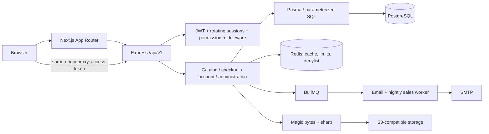

# AUREL Commerce

A Next.js App Router + Express commerce monorepo, with configurable product attributes, administrator/supervisor/customer roles, INR pricing, COD and WhatsApp orders. The starter brand is AUREL. This repository is a substantial implementation, **not a certified production release**. See [verification and remaining work](docs/STATUS.md) before launch.

## Local setup

Prerequisites: Node 22+, pnpm 11.25.0, Docker Desktop with Linux containers. PostgreSQL 16 and Redis 7 can also run outside Docker. The browser runs at `http://localhost:3000`, the API at `http://localhost:4000`.

```sh
corepack enable
pnpm install
docker compose up -d
cp apps/api/.env.example apps/api/.env
cp apps/web/.env.example apps/web/.env.local
# Set JWT_SECRET to a unique random value (48+ characters).
# Set SEED_PASSWORD in apps/api/.env to a unique strong password (12+ characters).
pnpm db:generate
pnpm db:migrate
pnpm db:seed
pnpm dev
```

PowerShell: replace `cp` with `Copy-Item` if preferred. Allow the documented Prisma, argon2, sharp and esbuild dependency build scripts when prompted by pnpm. Downloads and Docker image pulls determine whether first setup fits within ten minutes.

Start the mail worker in a second terminal, from `apps/api`:

```sh
node --env-file=.env --import tsx src/worker.ts
```

Seed accounts: `admin@aurel.local`, `supervisor@aurel.local`, `user@aurel.local`. All use the supplied `SEED_PASSWORD`; no fixed production password is included. Existing seed accounts are not overwritten by a repeated seed. The supervisor initially has only product read permission. Sign in as admin and grant creation/update permissions under Dashboard → People & permissions. Seed accounts are preverified; newly registered accounts verify through MailHog at `http://localhost:8025`.

MinIO console: `http://localhost:9001`, local-only credentials are in `compose.yaml`. The storage initialization job creates a public-read product image bucket. Original uploaded bytes are not retained; only re-encoded WebP derivatives are stored. Use a dedicated bucket and restricted service credentials in production.

## Commands

| Command                           | Purpose                                                              |
| --------------------------------- | -------------------------------------------------------------------- |
| `pnpm dev`                        | Web and API in watch mode                                            |
| `pnpm build`                      | Shared type check, bundled API/worker, production Next build         |
| `pnpm typecheck` / `pnpm lint`    | Type and static checks                                               |
| `pnpm test`                       | Unit tests; integration tests opt in with `RUN_INTEGRATION=1`        |
| `pnpm test:e2e`                   | Chromium and mobile Playwright journeys                              |
| `pnpm db:migrate`                 | Apply checked-in migrations (also production-safe migration command) |
| `pnpm db:seed` / `pnpm db:studio` | Demo data / Prisma browser                                           |
| `pnpm format`                     | Format source                                                        |

For integration tests, supply every API environment variable and a **disposable migrated database**, then set `RUN_INTEGRATION=1`. CI provisions PostgreSQL and Redis automatically. The full COD browser test additionally requires running API + worker and `E2E_PASSWORD` matching the seeded customer.

## Architecture



```text
apps/api/
  prisma/schema.prisma, migrations/, seed.ts
  src/auth.ts, middleware.ts        sessions, permissions, throttling
  src/catalog.ts, uploads.ts        dynamic catalog and image ingestion
  src/orders.ts, payments.ts        transactional stock and providers
  src/admin.ts, account.ts          administration and owned resources
  src/app.ts, server.ts, worker.ts  transport and process lifecycle
apps/web/src/
  app/                             storefront and dashboard routes
  components/ui/                   checked-in shadcn/Radix primitives
  components/dashboard/            lazy charts, grid, editing modules
  lib/store.ts                     Redux, RTK Query and guest state
packages/shared/src/               validation, permissions, money and sample data
e2e/                              Playwright journeys
infra/                            reverse proxy example
docs/                             API, ERD, adaptation and release status
```

API route modules currently compose validation, database calls and responses directly; order placement and payment providers are separated for service testing. A full controller/service/repository split and dependency injection container are outstanding architectural work.

## Important behavior

- All monetary values are **integer paise**. ₹2,499 is `249900`. Tax uses basis points, so 18% is `1800`.
- Checkout requires a verified account. Anonymous browsing, bag and wishlist are persisted locally. Guest checkout is not implemented.
- Server permissions are reloaded from the database on every authenticated request. UI visibility is convenience only.
- Product cross-owner changes require both `product:update` and `product:update:any` (similarly for delete). Analytics and identity/permission administration remain admin-only regardless of overrides.
- The category-specific JSON schema rejects unknown fields. Destructive attribute changes are blocked if existing products would become invalid.
- Checkout locks variant rows in stable ID order, atomically decrements available stock, creates immutable item snapshots and writes the order in the same transaction. Unique idempotency keys handle retries.
- Cancelling or returning an order restores inventory in a locked order transaction; terminal status re-entry is rejected.
- WhatsApp creates an order and provides an encoded link on its confirmation page. A deep link cannot establish that the customer actually sent a message. `whatsappSentAt` is deliberately left unset without a verified delivery signal.
- Development pages show a labelled read-only catalog preview if the API is offline. Production fails explicitly instead of substituting demo data.
- The dashboard grid, Recharts, MUI DataGrid and checkout are loaded only on the routes that use them. Nonce CSP makes the root rendering dynamic; full ISR is not claimed.

Further reading: [security](SECURITY.md), [deployment](DEPLOYMENT.md), [API](docs/API.md), [ERD](docs/ERD.md), [another domain](docs/ADAPTING.md), [go-live checklist](docs/GO_LIVE.md), [verification status](docs/STATUS.md).
