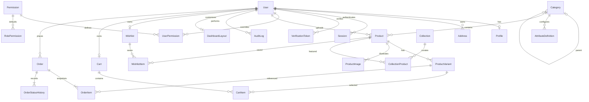

# Entity relationships

Product attributes, variant combinations, address snapshots, audit diffs and layouts use JSONB. Product attributes use a GIN index; names have a trigram index. Indexes support owner/date, status/date and payment/date order queries. Integrity checks enforce nonnegative stock and money. Audit UPDATE/DELETE is rejected by a database trigger.

Roles are a PostgreSQL enum with RolePermission defaults and per-user overrides. Historical commerce references use restricted deletes. Products are soft deleted; variants have an active flag; order items retain name, SKU, price, attributes and uploader/category snapshots.
